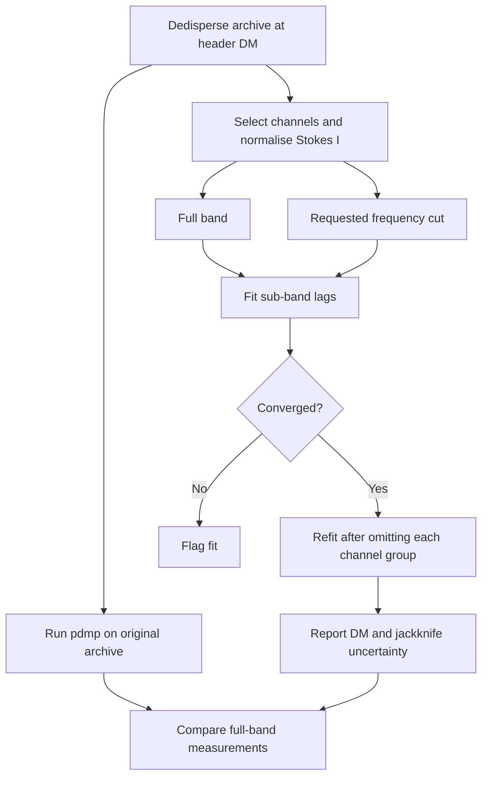

# Measuring component DMs on OzSTAR

[DM_comparison_align_v2.py](DM_comparison_align_v2.py) measures an **apparent alignment DM** from one folded, frequency-resolved component archive. It reports how the measurement changes with frequency coverage and compares the full-band estimate with `pdmp`. Use the same settings on the leading and trailing archives at each epoch. Inputs containing both components give a whole-profile estimate.

## Run

In a compute allocation, activate your pulsar environment and change into the `b1259-dm-alignment` directory. Check the dependencies with `python -c 'import psrchive, numpy, matplotlib'` and `command -v pdmp`. Ghostscript (`gs`) renders the pdmp page in the PDF. A missing pdmp executable leaves the alignment results available.

```bash
archives=/path/to/DM_latest/P116
python DM_comparison_align_v2.py "$archives" .T --debug -o p116_check

python DM_comparison_align_v2.py "$archives" .T \
  -j "${SLURM_CPUS_PER_TASK:-1}" --nsub 16 --min-snr 5 --jackknife 8 \
  --check-fmin 1400 --pdmp-args="-f -dm 157.5 -dr 17.5 -ds 0.001" \
  -o p116_alignment
```

The example requests a pdmp grid centred on 157.5, with half-range 17.5 and step 0.001 pc cm⁻³, for the proposed 140–175 cross-check. Inspect the saved pdmp log and plot to confirm the bounds and period search for your installation. Omitting `--pdmp-args` preserves pdmp defaults. The alignment fit has its own starting DM and uses no such search grid. [PSRCHIVE pdmp manual](https://psrchive.readthedocs.io/en/latest/manuals/pdmp.html)

The input search covers one directory level. Use distinct output prefixes per dataset and configuration. `--debug` processes the first sorted archive, prints its fit and cut diagnostics, and saves settings and the pdmp log. The full run also writes tables and the PDF. File names containing `pulse1` or `pulse2` set the plot labels.

`--check-fmin` accepts a frequency in MHz and can be repeated. 1400 MHz is an example for UWL. Choose a threshold **inside** the usable band for MeerKAT UHF. Use the same thresholds for both pulse components and compare their actual retained coverage. To check for an alternative solution when profiles are broad or the dispersion residual approaches a substantial fraction of a rotation, repeat with an independently plausible `--start-dm` and a different output prefix.

## Estimator



PSRCHIVE sums polarisations, applies the header DM, integrates in time and removes the baseline. The script excludes invalid channels, subtracts the median and divides by a robust estimate of channel noise. It groups frequency-sorted channels into 16 sub-bands by default. For each group it cross-correlates the summed profile against a filtered template formed from all other groups. A smooth Fourier-power filter suppresses weak harmonics. Interpolation around the correlation peak refines the relative lag.

A straight-line fit of lag in phase bins against dispersive delay per unit DM gives a DM correction and a free phase offset. The fit uses S/N² weights and requires at least three sub-bands above the S/N threshold. It stops when the magnitude of the remaining correction is at most the larger of 0.05 times the internal slope error and 10⁻⁷ pc cm⁻³. All diagnostics refer to the returned DM. After 20 updates an unconverged fit receives an explicit flag.

## What the uncertainty means

The default uncertainty is a **delete-group channel jackknife**. Eight groups are interleaved in frequency. Each refit omits one group, rebuilds the reference profiles and repeats the delay fit from the full solution while preserving the sub-band assignments. For equal group sizes the reported standard error is the population standard deviation of the replicate DMs times √(G−1), where G is the number of groups. For unequal group sizes the estimator uses deletion-fraction-weighted pseudovalues. The code requires at least twice as many channels as requested sub-bands, at least one channel per jackknife group, and a full set of converged replicates. An unresolved error is saved as NaN.

The jackknife measures sensitivity to channel sampling and noise under the assumption that the interleaved groups provide representative perturbations. Shared profile evolution, coherent frequency-dependent structure, residual dispersion within channels and scattering can bias all replicates together. The width of the jackknife distribution is an internal uncertainty. The full-band and frequency-cut estimates share data, so their difference and individual errors do not constitute an independent significance test.

## Outputs and reporting

| File or column | Meaning |
|---|---|
| `<out>.csv` | Full-band alignment and pdmp values per processed archive. `diff` is alignment minus pdmp. DM units are pc cm⁻³. |
| `err_align`, `fit_err_internal` | Channel-jackknife error and residual-scaled S/N-weighted slope error, respectively. Older revisions wrote the second quantity to `err_align`. |
| `quality` | `ok` means numerical convergence and a finite positive jackknife error. `iteration_limit` and `uncertainty_unresolved` identify diagnostic estimates requiring review. |
| `remaining_dm`, `updates`, `nsub_used`, `rms_resid_ms` | Remaining slope at the returned DM, completed updates, retained sub-band count and RMS of the fitted delay residuals. |
| `<out>_cuts.csv` | One row per requested cut and processed archive, including actual band edges, cut DM, error, cut minus full-band DM and fit status. A cut can fail independently of the full-band fit. |
| `<out>_settings.json`, `<out>_pdmp/` | Run arguments, raw pdmp command, exit status, output and available PostScript plots. |
| `<out>_failures.csv` | Archives for which processing failed. Compare with the input inventory. |
| `<out>.pdf` | Full-band comparisons, profiles centred independently for display, frequency-binned waterfalls, lag plots and available pdmp pages. The comparison panel uses paired results with `quality=ok`. |

For a component DM difference, compare the full-band and restricted-band values for **both** components. Examine the residuals and usable bandwidth on the same epoch. A stable numerical fit can still be biased. Report a strongly band-dependent offset as an apparent component DM difference. Establishing the electron-column DM in a strongly scattered observation needs a profile model or an independent constraint on the chromatic delay.

## Reproduce the numerical checks

Run `python verify.py` beside the analysis script. It uses NumPy, a fixed random seed, 64 channels between 704 and 4032 MHz, a 47.76-ms period, a header DM of 146.7 and 60 noise draws per case. These are tests of the estimator rather than measurements of B1259−63.

| Injected DM and profile | Fits with usable error | Mean bias | Median jackknife error | Injections within quoted error |
|---|---:|---:|---:|---:|
| 149, Gaussian | 60/60 | +0.00065 | 0.00725 | 41/60 |
| 144, Gaussian | 60/60 | +0.00129 | 0.00974 | 43/60 |
| 149, scattered Gaussian | 57/60 | +0.19365 | 0.01910 | 0/57 |

The scattered profile has an exponential tail of 0.37 ms at 1.4 GHz scaling as frequency to the power −4. For the full-band accepted trials with a converged high-frequency fit, the mean bias above 1400 MHz was +0.10074 pc cm⁻³. The original OzSTAR archives are required to determine the shifts for the data in the paper.
