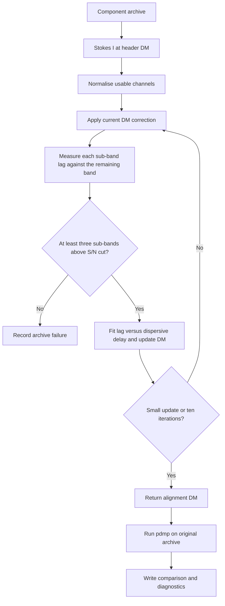

# Measuring component DMs with sub-band alignment on OzSTAR

[DM_comparison_align_v2.py](DM_comparison_align_v2.py) measures the apparent dispersion measure (DM) of one pulse component per folded archive. It compares the DM that aligns profiles across frequency with the DM returned by `pdmp` on the same archive. Both measurements use the same observation, so agreement is a consistency check with shared systematics.

## Run an observation

Start in an OzSTAR compute allocation with the pulsar software environment you normally use. The Python interpreter must be able to import PSRCHIVE, NumPy and Matplotlib. The executable `pdmp` must be on the path. Ghostscript (`gs`) enables the embedded PostScript plot.

```bash
cd OzSTAR-runbooks/b1259-dm-alignment
python -c 'import psrchive, numpy, matplotlib'
command -v pdmp
command -v gs
```

Supply a directory and the filename suffix of the archives. Prepare separate leading and trailing component archives in advance. Each needs frequency and pulse-phase resolution. The script analyses the whole profile it receives. Filenames containing lowercase `pulse1` or `pulse2` determine comparison-panel labels. Other filenames are grouped under `other`.

```bash
# Set this to your actual directory of component archives.
archives=/path/to/DM_latest/P116

# Inspect the first matching file, in sorted order.
python DM_comparison_align_v2.py "$archives" .T --debug -o p116_check

# Process all matching files in that directory.
python DM_comparison_align_v2.py "$archives" .T --nsub 16 --min-snr 5 \
    -j "${SLURM_CPUS_PER_TASK:-1}" -o p116_align
```

Run separately for P574 and MeerKAT with distinct output prefixes. The search covers one directory level. The debug run prints measurements and keeps raw pdmp output. The full run also writes the summary CSV and PDF. Give each run a fresh prefix to retain earlier results. Explicit `-j` keeps worker count within the allocation.

## How an archive becomes a DM



1. PSRCHIVE sums polarisations, dedisperses at the header DM, integrates in time and removes the baseline. The code drops zero-weight and constant channels, subtracts each retained channel's median and divides by its scaled median absolute deviation when positive.
2. Starting with zero correction to the header DM, it applies trial corrections as Fourier shifts. It sorts usable channels by frequency and splits them into 16 groups by channel count by default. For each group it sums the remaining channels into a reference profile and filters out weak Fourier harmonics. A circular cross-correlation with this reference gives the relative lag, sampled every 1/16 of a phase bin, and a matched-filter S/N.
3. For groups with S/N ≥ 5 by default, the fit is `lag = intercept + delta_DM × A`. Here `A` is the group's mean dispersive delay in phase bins per unit DM, computed from the individual channel frequencies. The fit weights are S/N squared. The slope is added to the current DM correction. Iteration stops when the absolute slope is below 0.05 times its estimated error or after ten updates.
4. The script runs `pdmp -g <plot>/vcps <archive>` with no explicit DM search limits or step size. A claim of 140–175 in steps of 0.001 requires separate evidence for the production command.

## Read the outputs

| Output | Interpretation |
|---|---|
| `p116_align.csv` | One row per successfully processed archive. `dm_align` and `dm_pdmp` are in pc cm⁻³. `diff` is alignment minus pdmp. `nsub_used` counts retained sub-bands in the last fit. |
| `err_align` | Empirical slope standard error from the S/N-weighted fit. The code multiplies the slope variance from the inverse normal matrix by weighted residual sum of squares divided by N−2, including when this factor is below one. |
| `rms_resid_ms` | S/N²-weighted RMS about the fitted delay line in the last iteration, in milliseconds. |
| `p116_align.pdf` | Component comparison, then two pages per archive showing the two dedispersed profiles and waterfalls, sub-band delays, and pdmp's diagnostic page if available. Each waterfall is independently centred on its summed-profile peak. |
| `p116_align_pdmp/` | Raw pdmp terminal output and any PostScript files for checking fits or parser failures. |

## What can go wrong

**The error bar measures scatter about the fitted line.** The code passes 1/S/N as a relative lag-error proxy. Pulse width and shape also affect timing precision, and the different sub-bands share reference data. Template covariance and profile evolution are omitted. A smooth systematic delay can change the slope while leaving very small residuals. Even a zero error is possible if all quantised lags coincide. Describe this as an internal fit uncertainty.

**A stable result depends on the starting DM.** V2 starts at the header DM without a preliminary search. Circular lags wrap at half a period and a weak or broadened pulse can give an ambiguous peak. The ten-update limit has no convergence flag. The returned DM includes the final update, but the tabulated error, RMS and selection mask come from the fit before it. For a production revision, record the number of iterations and final correction, flag exhausted fits, and recompute diagnostics at the returned DM.

**Gaps and reference profiles affect interpretation.** Waterfall rows are plotted uniformly from minimum to maximum frequency even when zapped channels leave gaps. The white crosses are relative lags against different templates, offset to phase 0.5. They are approximate guides to alignment. Near periastron, use the same frequency cuts for both components and check whether the component DM difference changes when the most broadened channels are excluded. Simulations with observed profile shapes or a joint DM–scattering fit would be needed to quantify the bias for an epoch.

**The summary plot can fail even after the CSV was written.** If a pulse group has no parsed pdmp DMs, the axis-limit calculation takes a minimum of an empty array. Zero alignment errors or identical pdmp DMs can also invalidate the summary regression. The fitted comparison line weights only the alignment errors, although both axes have uncertainty. Check the terminal log, count successful rows and inspect raw pdmp output before interpreting the PDF.

## Reproduce the numerical check

Run `python verify.py` alongside the script. Only NumPy is needed for this synthetic check. It exercises the alignment functions with 64 channels spanning 704–4032 MHz, a 47.76-ms period, a Gaussian component and 60 independent noise draws per case. The header DM is 146.7. The scattered case adds an exponential tail with a timescale of 0.37 ms at 1.4 GHz scaling as frequency to the power −4.

| Injected DM | Profile | Mean DM bias | Median reported error | Inside quoted error |
|---:|---|---:|---:|---:|
| 149 | Gaussian | +0.00035 | 0.00921 | 41/60 |
| 144 | Gaussian | +0.00081 | 0.01022 | 38/60 |
| 149 | Scattered Gaussian | +0.19543 | 0.02119 | 0/60 |

DM values and errors are in pc cm⁻³. These checks exercise the sign, scale and fitting code. They exclude archive loading, component extraction and the external pdmp executable. The scattered example illustrates a possible bias. Its magnitude depends on the observed profile, usable band and S/N at each epoch.
